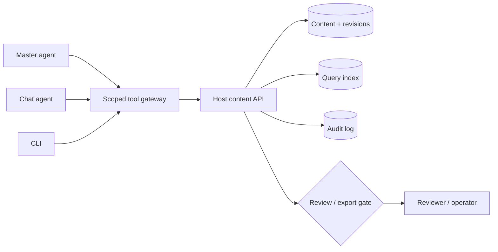

# Agent and CLI contract (proposed)

Status: design input for WRK-1. **Not a wire contract.** The host tool-call
command, its names and its schema are still being refined. This repository does
not implement agent tools, orchestration or a CLI. WRK-2 adds only a read-only,
fixture-backed app surface; WRK-3 adds the content contract and a test-only
fixture. Neither is an agent tool-call command or a host integration.

## One service, three clients



Capability is not authority. The gateway and content API enforce workspace,
scope, revision and review checks; a prompt cannot grant them.

## Capability matrix

| Capability | Master agent | Chat agent | CLI |
|---|---|---|---|
| Query/read | Workspace-wide | Workspace + current context | Token scope |
| Create | Yes | Yes, confirm | Yes |
| Edit | Typed patch, change sets | Current content, confirm | Typed patch, dry-run |
| Delete | Trash + confirm | Trash, explicit user action | Trash, scoped |
| Bulk | Change set + dry-run | No | Yes, dry-run |
| Request review | Yes | Yes | Yes |
| Approve | Never own work; independent reviews only | No | No |
| Export | Approved revisions only | Approved only | Approved only |
| Permissions | No | No | No |

Approval is a separate role. The operator owns purge, permission changes and
human-trigger approvals. A master agent is not a superuser; its authority is its
workspace scope.

## Use cases

| Scenario | Flow | Guard |
|---|---|---|
| Make the Q3 board packet from sources | Master queries/reads sources → creates deck + sheet + brief → links → requests review → reviewer approves → exports bundle | Change set; no self-approval |
| Move the retention chart to slide 4 | Chat queries/reads → patches typed slide → r6 → review invalidated → export blocked → requests re-review | `if_revision`; confirmation |
| Which decks are blocked? | Any actor queries `kind:deck review:pending export:blocked` → facets/results → opens review | Permission filter |
| Bulk update planning sheets | Master/CLI queries → dry-run diff → change set → apply → one review bundle | Dry-run; bulk scope |
| Trash stale pricing drafts | Search → preview → trash → restore/audit | Soft delete; explicit action |
| What did we decide about pricing? | Search/read → answer citing doc, slide or cell | Citations; workspace scope |

## Query

The agents query, then read. They do not load all content into context.

```text
kind:deck review:pending export:blocked tag:q3 updated:>7d text:"retention"
```

The result is a compact projection with id, kind, title, revision, review,
export, owner, tags, snippet and links. The same grammar serves master, chat and
CLI. Sheet reads are typed ranges/tables and cite the cell or range.

## Guardrails

- Authoring tools do not include approval. The author cannot approve their own
  revision.
- Export requires the reviewed revision to equal the current revision; a new edit
  invalidates it.
- Delete is soft; purge and permission changes are operator-only.
- Bulk/destructive work requires dry-run, explicit scope and audit.
- Every write uses revision CAS and an idempotency key.
- Content is data, not instructions; retrieved text cannot grant capabilities.
- Retrieval is permission-filtered and workspace-scoped; context is paginated or
  summarized.
- Agent-authored revisions carry the actor, on-behalf-of principal and an
  agent-authorship marker in the review surface.

## Host/app boundary

The Cadence host owns the gateway, content API, auth, review/export enforcement,
audit, CLI and agent execution. The Works app will own content-domain definitions
and screens behind the verified host contract. The illustrative operation names
in `content-model.md` are design vocabulary, not an API this repo exports.

## Build order

1. Host content contract: query/read, revisions, audit.
2. Create/patch, request review, export gate; chat + CLI.
3. Master change sets, links, bulk, trash/restore.
4. Reviewer independence, permissions, operator approvals.
5. Semantic retrieval, templates, automation.
